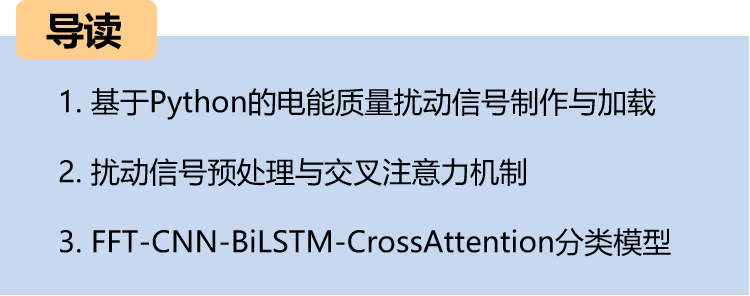
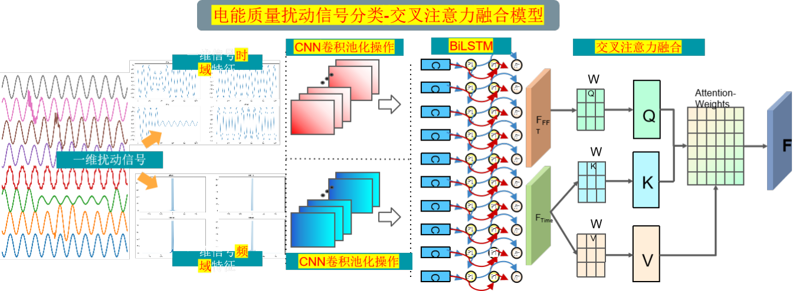
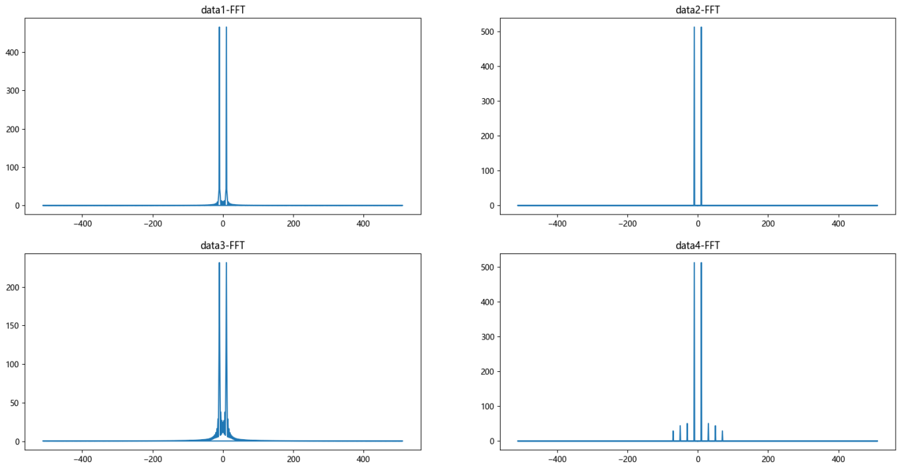
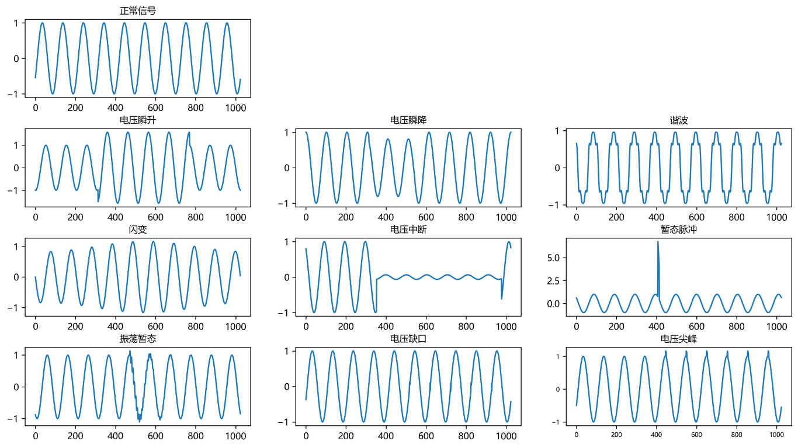
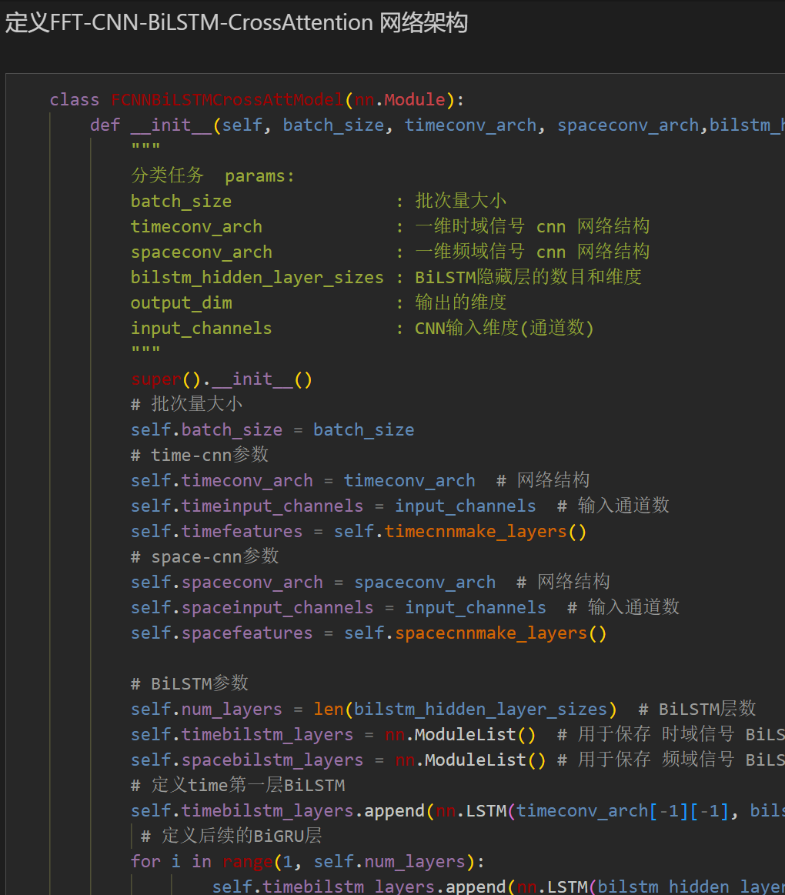
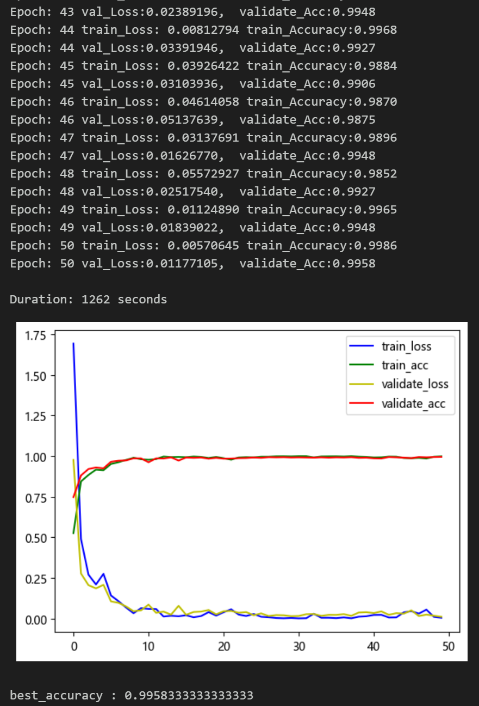
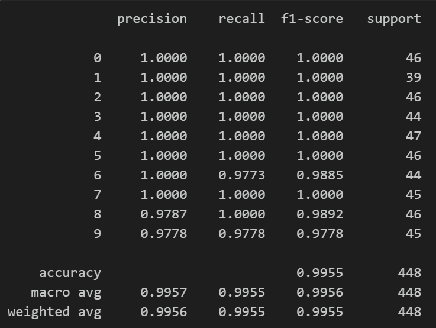
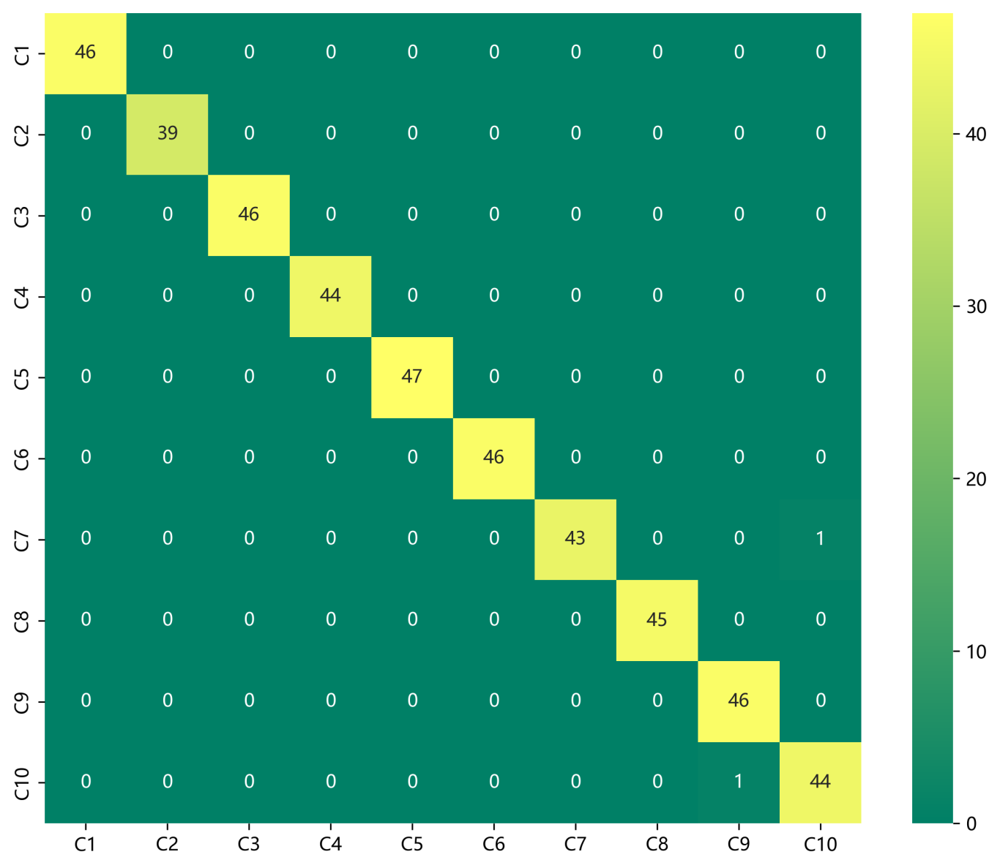
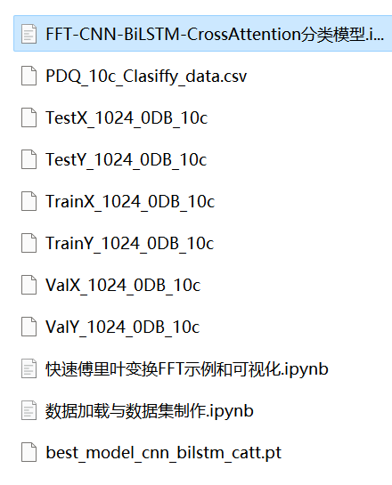

# Cross Attention FFT + CNN -BiLSTM-CrossAttention Power Quality Disturbance Identification Model for Time-Domain and Frequency-Domain Features

Thesis innovation!!!
The cross-attention mechanism can model the degree of correlation between different features, extracting important features from both frequency and time domain characteristics for model recognition, with significant effects.
50 epochs, with 100% accuracy. The FFT+CNN-BiLSTM-CrossAttention network achieves significant results in classification. The model can fully extract spatial and temporal features as well as frequency domain features from perturbation signals. It converges quickly and performs exceptionally well, currently the highest precision method among previous articles. Innovation is also present!!!
Includes a complete dataset of power quality disturbance signals, as well as a fully generated and prepared dataset of ten types of disturbance signals, classified data, and label sets, all of which can be run.
Includes code for data preprocessing and the FFT+CNN-BiLSTM-CrossAttention classification model.
Environment: Python 3.9
Innovation Point: Utilizing cross-attention mechanism to fuse the model!
Preface
This article introduces the FFT (Fast Fourier Transform) for data preprocessing and the implementation of a CNN-BiLSTM-CrossAttention model based on FFT for classifying power quality disturbance signals using Python. For more detailed information about the simulation of power quality disturbance signals in Python, please refer to the following text (Appendix 10 contains the 10-class dataset):
\tPython - Data Introduction and Classification of Electric Power Quality Disturbance Signals
The waveform diagram of some disturbed signal types is as follows:
\t  
Overall Model Structure
The overall structure of the model is as follows: The one-dimensional perturbation signal undergoes FFT transformation to extract its frequency domain features, and the signal itself's time domain features are processed through CNN convolutional pooling operations to extract global features. Subsequently, BiLSTM is used to extract sequential features. The attention mechanism is employed to fuse both time-domain and frequency-domain features. By calculating attention weights, the model focuses on important features for feature enhancement and fusion. Finally, the classification results are output through fully connected layers and softmax.
Time-domain and frequency-domain feature extraction:
Applying FFT to the time-domain signal to convert it into the frequency domain.
Utilize Convolutional Neural Networks (CNN) to learn and extract frequency domain features. The convolutional layers of CNN can capture local patterns in the frequency domain features.
\tBiLSTM network:
Input the time-domain signal into the BiLSTM network. The BiLSTM (Bidirectional Long Short-Term Memory Network) can effectively capture the long-term dependencies of the time-domain signals.
Cross-attention mechanism:
\tThe cross-attention mechanism is used to fuse time-domain and frequency-domain features. This can be achieved by calculating attention weights, allowing the model to focus more on important features.
1. Introduction to the Principle of Fast Fourier Transform (FFT)
\tThe Fourier Transform is a tool for signal processing and spectral analysis, used to convert a signal from the time domain to the frequency domain. The Fast Fourier Transform (FFT) is an efficient algorithm for implementing the Fourier transform, particularly suitable for the processing of discrete signals.
Step 1: Import partial data, visualize disturbance signals.
\t  
Step two, the perturbation signal is visualized through FFT.
2. Data Preprocessing for Disturbance of Electric Energy Quality
2.1 Import Data
A disturbance signal model is constructed based on the IEEE Std1159-2019 Power Quality Detection Standard and related literature. Ten types of single signals and various composite disturbance signals are generated, including normal signals. Preprocessing for the 10-class classification of disturbance signals is conducted in reference to previous articles.
Step 1: Generate a single signal according to the formula model.
\t  
Single disturbance signal visualization:
\t  
2.2 Dataset Production
\tCreating dataset and classification labels
\t  
3 Cross Attention Mechanism
\t3.1 Cross Attention Concept
\tThe two sequences must have the same dimensions.
\tThe two sequences can be different patterns (such as: text, sound, image).
A sequence as input defines the output sequence length, and another sequence provides the input K&V.
3.2 Cross-attention Algorithm
\tCalculate K and V for S1.
Calculate Q for S2
\tCalculate the Attention Matrix Based on K and Q
\tApply V to the Attention Matrix
The output sequence length is consistent with S2.
During the fusion process, we use the frequency domain features transformed by FFT as query sequences and temporal features as key-value pairs. By calculating the attention weights between the query sequences and the key-value pairs, we can model the degree of association between different features.
4. FFT+CNN-BiLSTM-CrossAttention Perturbation Signal Identification Model
4.1 Network Definition Model
\tNote: The input fault signal data shape is [64, 1024], batch_size=64, where 1024 represents the length of perturbation signal sequence.
4.2 Set parameters and train the model
50 epochs, accuracy nearing 100%. The FFT + CNN-BiLSTM-CrossAttention integrated network model significantly improves classification results. The model effectively extracts spatial and temporal features as well as frequency domain features from disturbance signals in power quality. It converges quickly, exhibits superior performance, high accuracy, and the cross attention mechanism models the degree of association between different features. It effectively extracts critical features for model identification from both the frequency and time domain characteristics of disturbance signals, resulting in noticeable improvements.
4.3 Model Evaluation
Accuracy, Precision, Recall, F1 Score
Classification Confusion Matrix:
Previously Featured Content:
Introduction to Python-Power Quality Disturbance Signal Data and Classification
Classification of One-Dimensional Signals Based on LSTM Model in Python Power Quality Disturbance Signal Classification (Part I)
Classification of One-Dimensional Signals Based on CNN Model in Python Power Quality Disturbance Signal Classification (Part II)
Classification of One-Dimensional Signals Based on Transformer Model in Python Power Quality Disturbance Signal Classification (Part III)
Classification of One-Dimensional Signals Based on CNN-BiLSTM Model in Python Power Quality Disturbance Signal Classification (Part IV)
Classification of One-Dimensional Signals Based on CNN-Transformer Model in Python Power Quality Disturbance Signal Classification (Part V)
Power Quality Disturbance Identification Model with FFT + CNN - BiGRU-Attention Attention Fusion of Time and Frequency Features

## Images

<!-- PAYMENT_BLOCK -->

## Get this dataset

- Payment link (Stripe): [Buy now](https://buy.stripe.com/3cs8yP7sY87d0vu9AB)
- Payment QR code: 

<!-- /PAYMENT_BLOCK -->
